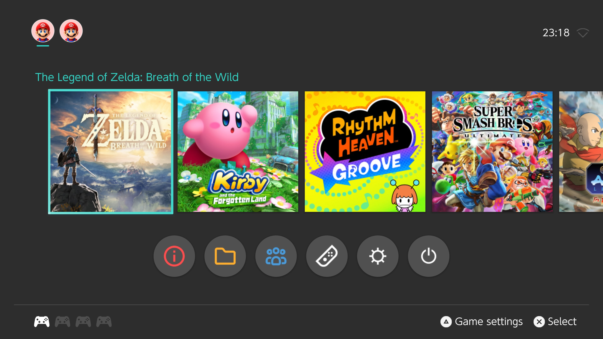
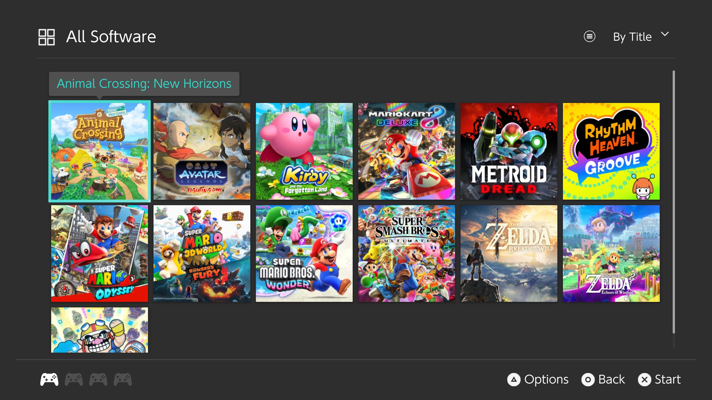
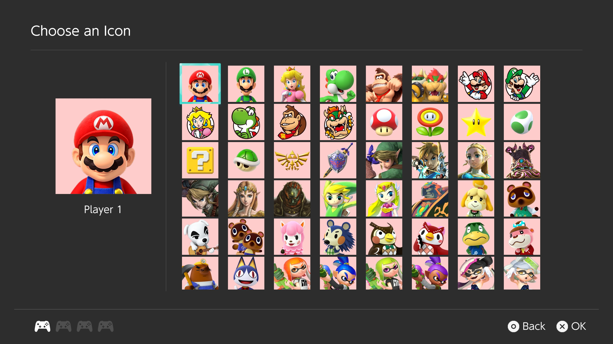
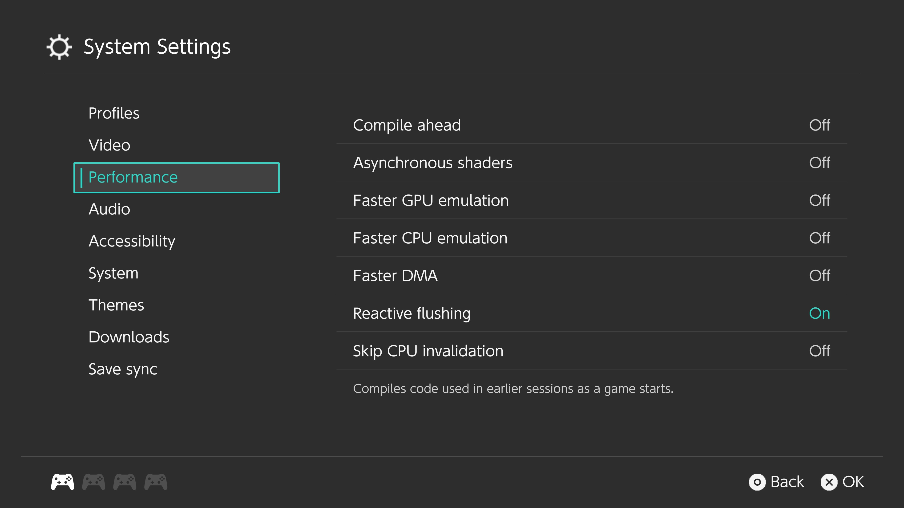

# SwitchLauncher

A Nintendo Switch-inspired launcher for [ProsperoEden](https://github.com/blackbearreloaded/ProsperoEden) on PS5, maintained by [kasobos67](https://github.com/kasobos67).

SwitchLauncher brings the custom **Switch UI** interface to ProsperoEden as an installable Lua launcher pack. It provides its own HOME screen, software library, menus, artwork, transitions and interface sounds while using ProsperoEden's existing emulation backend and services.

## Compatibility

Minimum required ProsperoEden version: **1.004.000**.

## Interface









Screenshots supplied by the project author. Games shown are not included.

- Switch-inspired HOME screen with twelve game positions, light/dark blank tiles, library navigation and title bubbles.
- Profile selection and profile artwork.
- Light and dark appearances, transitions and the original interface sound mapping.
- Dedicated controllers, multiplayer and game-files shortcuts.
- Access to supported ProsperoEden settings and services.
- Launcher updates in About, with a separate Credits window.
- A **ProsperoEden Update** dialog for application updates, using the same progress-bar style as launcher updates.
- Optimized Lua drawing, query and layout handling.

The interface is English-only and uses a fixed layout. New ProsperoEden features may require an updated launcher before controls for them appear here.

## Installation

Install or update to the official **ProsperoEden 1.004.000** app before adding this pack.

1. Download the attached **`SwitchLauncher-<version>.zip`** from this repository's [Releases](https://github.com/kasobos67/SwitchLauncher/releases). Use the named launcher ZIP, rather than GitHub's automatically generated source-code archive.
2. Close ProsperoEden completely.
3. Extract the ZIP. It contains a folder named **`switch-ui`**.
4. Using your usual PS5 file-transfer method, copy that folder into:

   ```text
   /data/prosperoeden/launchers/
   ```

   The resulting path must be:

   ```text
   /data/prosperoeden/launchers/switch-ui/manifest.json
   ```

5. Open ProsperoEden. In its built-in interface, go to **Settings → Appearance → Launcher**, then select **Switch UI**.

Keep the folder name `switch-ui`. The repository is called SwitchLauncher, while the internal pack ID remains `switch-ui` to preserve existing launcher state.

The pack uses your established `/data/prosperoeden` data. It does not replace the application executable, emulator core, profiles, game folders or save data. A standalone SwitchPS5 installation is not needed.

### Moving from an earlier test pack

If your installed pack already uses the SwitchLauncher feed below, install this version through **About → Check for updates → Update** after updating ProsperoEden. There is no need to copy the pack again.

Earlier test packs using another repository/feed need one manual installation using the steps above. Ordinary updates deliberately cannot change the feed address.

Preserve this file when replacing the pack:

```text
/data/prosperoeden/config/launcher-state/switch-ui.json
```

That keeps launcher-specific choices such as the light/dark appearance, profile artwork and recent-game ordering. Do not delete the surrounding data folder, profiles or saves.

## How updates work

**SwitchLauncher updates and ProsperoEden application updates are separate.**

| Update | What it updates | Where it comes from |
| --- | --- | --- |
| ProsperoEden application update | The application, emulation backend and native services | The **ProsperoEden Update** dialog and ProsperoEden's own update system |
| SwitchLauncher update | This launcher's Lua code, layout, artwork and sounds | This repository's launcher releases |

Updating SwitchLauncher does not update the emulator. Updating ProsperoEden does not automatically update this launcher. Compatible application updates preserve the launcher in the data directory.

Once this pack is installed, open **About** from the HOME screen, choose **Check for updates**, then **Update** when a compatible release is offered. With automatic launcher checks enabled, Switch UI requests a background check after boot and after returning from a game. **Updates are installed only after confirmation.**

Each release has its own version and download link. The application reads a permanent feed at:

```text
https://raw.githubusercontent.com/kasobos67/SwitchLauncher/update-feed/launcher-updates.json
```

Publishing a stable release runs the repository workflow. It validates the uploaded launcher ZIP and updates that feed with its version, download address, size, checksum and compatibility requirements. Older compatible entries are retained, and the host chooses the newest version it can run. Drafts and prereleases are excluded from the stable feed.

### Test versions

**Switch UI Test** is a separate optional pack for trying changes before they reach stable users. It uses the same ProsperoEden 1.004.000 launcher API and includes the same performance improvements. Install the test pack manually once, then receive later test versions through its own About menu. The stable pack cannot install the test pack through its updater.

| | Stable | Test |
| --- | --- | --- |
| Launcher name | Switch UI | Switch UI Test |
| Pack folder / ID | `switch-ui` | `switch-ui-test` |
| Development branch | `main` | `test-versions` |
| Release tag | `v1.004.002` | `test-v1.004.002` |
| Release asset | `SwitchLauncher-1.004.002.zip` | `SwitchLauncher-Test-1.004.002.zip` |
| GitHub release type | Stable release | Prerelease |
| Feed branch | `update-feed` | `test-update-feed` |

The test pack's permanent feed is:

```text
https://raw.githubusercontent.com/kasobos67/SwitchLauncher/test-update-feed/launcher-updates.json
```

Extract `SwitchLauncher-Test-<version>.zip` and copy its **`switch-ui-test`** folder into `/data/prosperoeden/launchers/`. Select **Switch UI Test** through the launcher's **System Settings → Themes → Launcher**, or the built-in launcher's **Settings → Appearance → Launcher**. Both packs can remain installed; use that same picker to switch back to stable.

Appearance, profile artwork, recent ordering and updater diagnostics are separate for each pack. The test pack stores them in `/data/prosperoeden/config/launcher-state/switch-ui-test.json`. Native emulator settings, native user profiles, games and saves are shared. Switching packs does not copy or delete either pack's preferences.

Test builds are experimental. Installing a new test version still requires confirmation. Stable users are never offered test releases by the stable feed. Each channel has its own version sequence; the installed manifest always uses three numeric components, without a `-test` suffix.

See [TESTING.md](TESTING.md) for initial GitHub setup, test publication and promotion to stable.

The host validates the downloaded pack, preserves saved state and retains the previous version for recovery. No GitHub account or token is needed on the PS5.

### Will another manual installation be needed?

Normal compatible launcher updates can be installed through About. A manual installation may still be needed if the permanent repository/feed address changes or the installed host can no longer open the pack. A release requiring a newer ProsperoEden version is offered only after the host meets its compatibility requirements; update the application first, then check for the launcher update again. Saved-state schema changes require an explicit migration rather than being silently installed. Changing the publisher is intentionally not an ordinary automatic update.

Launcher versions are independent of ProsperoEden versions. A new backend setting is not automatically added to this fixed interface; the launcher author must expose it in a later pack update. Users can receive that change through this repository's updater without rebuilding ProsperoEden.

## Returning to the built-in launcher

In Switch UI, open **System Settings → Themes → Launcher**, then choose **Built-in launcher**.

If the interface cannot open, close the app and create an empty file at:

```text
/data/prosperoeden/config/force-builtin-launcher
```

Restart the app to use the built-in interface. Remove that recovery file before selecting an external launcher again. The installed pack and saved launcher state can remain in place.

## Source and releases

This repository contains the launcher and its release tools. ProsperoEden itself remains in the [upstream repository](https://github.com/blackbearreloaded/ProsperoEden).

```text
src/                  Lua presentation and motion source
assets/               Artwork, font and sound resources
manifest.json         Pack identity, version and permanent update address
loading.json          Loading-screen presentation
tools/                Local pack builder and release-feed publisher
tests/                Packaging, publisher and refresh-policy tests
.github/workflows/    Stable/test feed publishers and test-branch pack builds
```

One large artwork atlas is stored as `.tga.gz` so the complete source can be uploaded through GitHub's website. The pack builder restores the original TGA bytes; the installed artwork is unchanged. The source archive therefore needs packaging before it can be installed.

## Credits and licensing

- **Eden developers and contributors:** emulation core.
- **[BlackBearReloaded](https://github.com/blackbearreloaded):** ProsperoEden and its PS5 port.
- **[kasobos67](https://github.com/kasobos67):** Switch UI integration and SwitchLauncher maintenance.
- **Nintendo:** original Switch interface artwork, profile resources, font resources and interface recordings used by this presentation.

Nintendo-derived resources were extracted from decrypted Switch firmware to reproduce the original presentation and sound mapping faithfully. No firmware dump, decryption keys, games, saves or account credentials are included.

Project source code is covered by [GPL-3.0-or-later](LICENSE). Third-party resources retain their owners' rights and are described in [ASSET_NOTICES.md](ASSET_NOTICES.md); that code license does not relicense them. SwitchLauncher is an independent project and is not affiliated with Nintendo or Sony.
